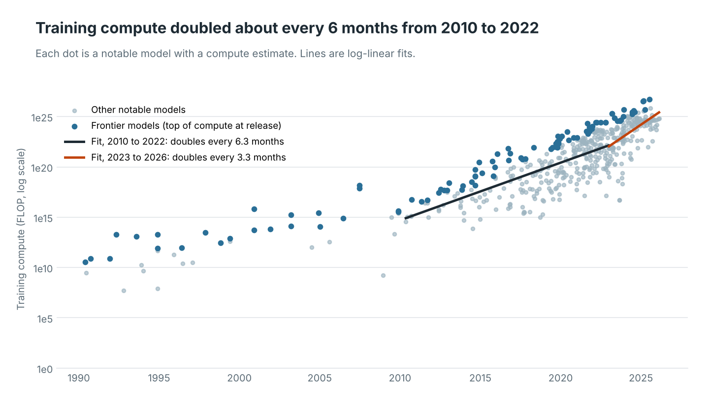
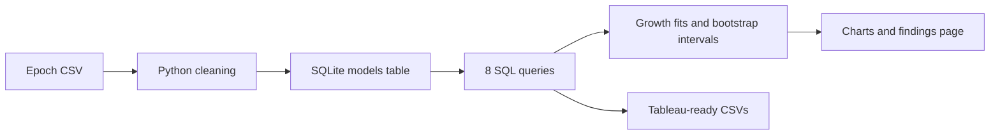

# AI Compute Trends

[](https://github.com/tavialaw7/ai-compute-trends/actions/workflows/checks.yml)
[](https://tavialaw7.github.io/ai-compute-trends/)

A SQL and Python analysis of 1,011 notable AI models from [Epoch AI](https://epoch.ai/data/ai-models): how fast training compute grew, who builds the models, and how open they are.

**[Read the findings page](https://tavialaw7.github.io/ai-compute-trends/)**



## Findings

- **Compute.** From 2010 to 2022, training compute doubled about every **6.3 months** (95% bootstrap interval 5.8 to 6.9, 306 models). The 2023 on estimate is faster, at 3.3 months, but it is fragile: a short window, a partial 2026, and falling data coverage.
- **Who builds.** Industry alone built **92%** of notable models in 2025. Academia built 32% in 2015 and 2% in 2025.
- **Openness.** The open-weights share fell from **56%** in 2020 to **40%** in 2025. From 2022 to 2025, 33% of industry-built models had open weights, against 70% for academia.
- **Geography.** US developers made 62% of notable models from 2022 to 2025. China's share doubled from 12% to 24% between 2018-2021 and 2022-2025.
- **Data gaps.** Only 521 of 1,011 models have a compute estimate, and coverage drops from 80% in 2021 to 37% in 2025. Every growth rate describes models with estimates only.

## How it works



The questions live in [`sql/queries/`](sql/queries), one file per question, using window functions for medians and shares. Python handles the parts SQL is poor at: log-linear fits, bootstrap intervals and charts. The schema is in [`sql/schema.sql`](sql/schema.sql).

## Run it

```bash
pip install -e .
ai-compute-trends          # regenerates outputs/ and docs/
python -m unittest discover -s tests -v
```

Requires Python 3.10 or later, NumPy and Matplotlib. Use `--data` to point at a different copy of the CSV.

## Tableau

`outputs/tableau/` holds two tidy CSVs ready to connect to Tableau Public or any BI tool:

- `models_clean.csv`: one row per model with cleaned sector, country, openness, frontier flag, compute and a `log10_compute_flop` column.
- `yearly_summary.csv`: one row per year with coverage, median compute, sector shares and open-weights share.

## Data

Epoch AI, "Data on AI models", licensed CC BY 4.0. The CSV in `data/` is a snapshot from a public GitHub mirror, not a direct download from Epoch, so it may differ from their current release. Details and the refresh link are in [data/README.md](data/README.md).

## Limits

- "Notable" is Epoch's judgment, so inclusion rules shape every share.
- Compute estimates are missing for about half the models, probably not at random.
- Bootstrap intervals capture sampling noise only, not estimate error or selection bias.
- Era boundaries (2010, 2023) are my choices.
- Shares count models, not their importance. Sector and year are mixed in the openness comparison, so it shows a pattern and not a cause.

MIT licensed code. Built by [Tavia](https://github.com/tavialaw7).
